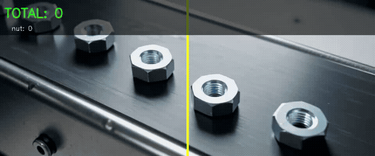
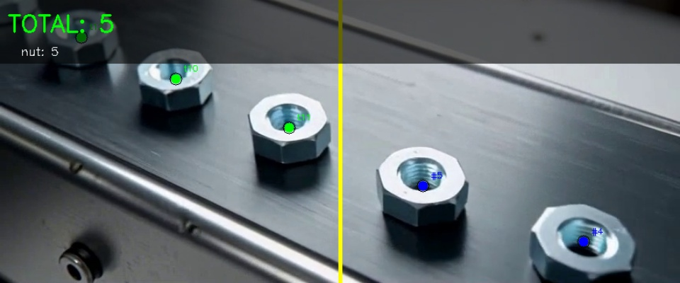

# Nut Counting System

A computer vision pipeline for detecting, tracking, and counting nuts on conveyor-style video using YOLO-NAS + ByteTrack. Includes confidence calibration, count uncertainty estimation, and a Streamlit dashboard.

## Architecture

```
Camera/Video → YOLO-NAS Detection → ByteTrack Tracking → Line-Crossing Counter → CSV Log + Dashboard
                                                    ↓
                                         Calibration + Uncertainty (± error)
```

- **Detection:** YOLO-NAS-S (19M params), trained on 566 source images across 3 Roboflow datasets
- **Tracking:** ByteTrack via supervision
- **Counting:** Direction-aware line crossing (left→right), configurable ROI
- **Calibration:** Isotonic regression (ECE = 0.006)
- **Statistics:** Wilson score intervals, per-batch uncertainty reports
- **Dashboard:** Streamlit

## Results (on demo video, cropped_nuts.mp4)

| Metric | Value |
|--------|-------|
| Detection mAP@0.50 (nut) | 0.865 (pycocotools, nut-only) |
| Combined mAP@0.50 (nut+bolt) | 0.451 (bolt class not operational — 27:1 imbalance) |
| Calibration ECE | 0.006 (isotonic regression) |
| Counted on demo clip | 8 line crossings |
| Counting reliability | All 8 events rated HIGH confidence |
| Count uncertainty | ±1 (95% CI [6, 11]) |

A larger manually labeled video dataset is needed for stronger counting accuracy claims.

## Demo





## Setup

### 1. Environment

```bash
conda create -n nut-counter python=3.10 -y
conda activate nut-counter
pip install -r requirements.txt
```

### 2. Datasets

Download these Roboflow datasets in **COCO format** and extract into `data/raw/`:

| Dataset | Link |
|---------|------|
| Nut Counting System | https://universe.roboflow.com/object-detection-39ltk/nut-counting-system |
| Nuts and Bolts Detection | https://universe.roboflow.com/bishe-rqa1b/nuts-and-bolts-g8ni8-ar1eb |
| Nuts and Bolts Segmentation | https://universe.roboflow.com/jente-kleinh/nuts-and-bolts |

Expected structure:

```
data/raw/
├── nut_counting/
│   ├── train/  (_annotations.coco.json + images)
│   └── valid/
├── nuts and bolts.v1i.coco/
│   ├── train/
│   └── valid/
└── Nuts and Bolts.v1i.coco/
    ├── train/
    ├── valid/
    └── test/
```

### 3. Prepare Data

```bash
python scripts/prepare_data.py
```

Creates a combined 4-way split (train/val/calibration/test) in `data/processed/combined/`.

### 4. Train

```bash
python scripts/train.py --model yolo_nas_s --epochs 150 --batch-size 6
```

Training takes ~2 hours on an RTX 3060 6GB.

### 5. Calibrate

```bash
python scripts/calibrate.py
```

Fits isotonic regression and saves the calibrator to `checkpoints/calibrator.pkl`.

### 6. Run Pipeline

```bash
python -c "from src.pipeline import run_pipeline; run_pipeline()"
```

Edit `configs/default.yaml` to set your video source and counting line.

### 7. Dashboard

```bash
streamlit run app.py
```

## Configuration

All runtime settings in `configs/default.yaml`:

```yaml
model:
  name: yolo_nas_s
  checkpoint: checkpoints/.../ckpt_best.pth
  num_classes: 2
  class_names: ["nut"]

pipeline:
  confidence_threshold: 0.25
  device: cuda
  source: data/videos/cropped_nuts.mp4

counting:
  count_line: [[432, 0], [432, 360]]
  count_direction: left_to_right
```

## Project Structure

```
conveyor-counter/
├── configs/default.yaml           # Runtime pipeline config
├── app.py                         # Streamlit dashboard
├── src/
│   ├── pipeline.py                # 4-thread pipeline (Camera→Detect→Track→Viz)
│   ├── tracking.py                # ByteTrack wrapper
│   ├── counting.py                # Direction-aware line crossing + gates
│   ├── calibration.py             # Isotonic regression calibrator
│   ├── statistics.py              # Wilson CI + batch reports
│   ├── alerts.py                  # Jam detection + gap alerts
│   ├── visualization.py           # OpenCV overlay rendering
│   ├── exporters.py               # CSV logger
│   └── config.py                  # Typed config loader
├── scripts/
│   ├── prepare_data.py            # Multi-dataset merge + 4-way split
│   ├── train.py                   # YOLO-NAS training
│   ├── calibrate.py               # Calibration fitting + reliability diagram
│   ├── evaluate.py                # pycocotools evaluation
│   └── evaluate_run.py            # Counting metrics from CSV
├── assets/                        # Demo screenshots and videos
├── reports/                       # Metrics, plots, final report
├── DESIGN.md                      # Full technical design document
└── requirements.txt
```

## License

This project uses YOLO-NAS which has its own [license terms](https://github.com/Deci-AI/super-gradients/blob/master/LICENSE.YOLONAS.md). Datasets are CC BY 4.0 / Public Domain as noted on their Roboflow pages.
